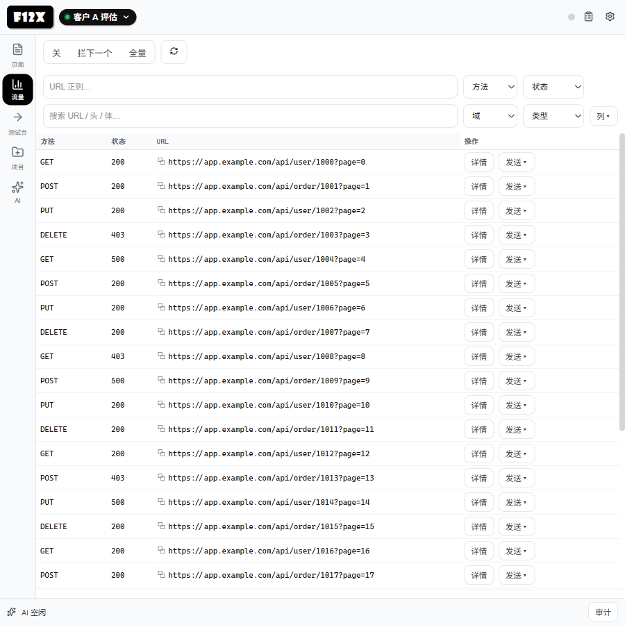
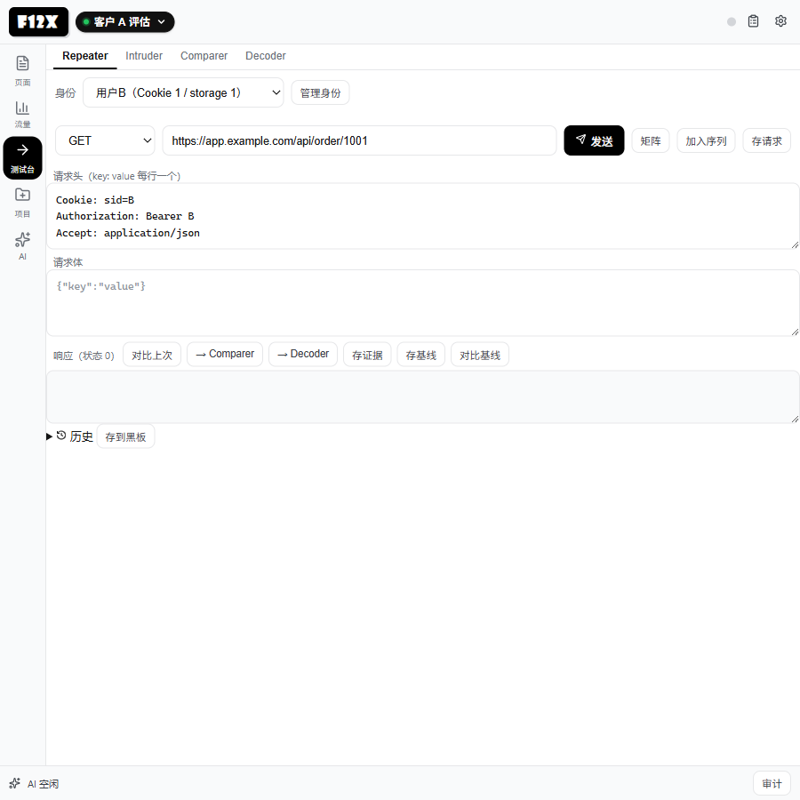
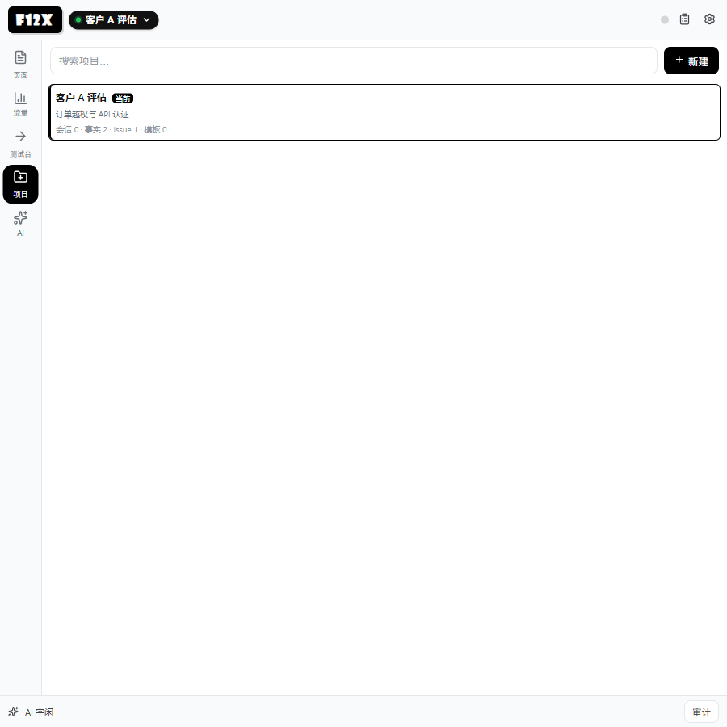
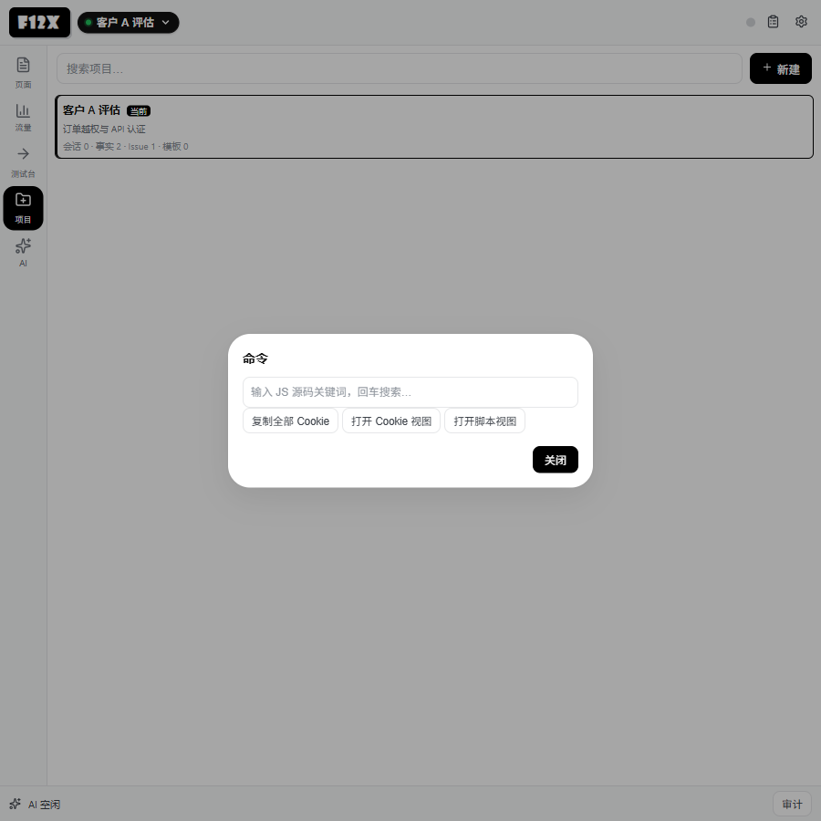
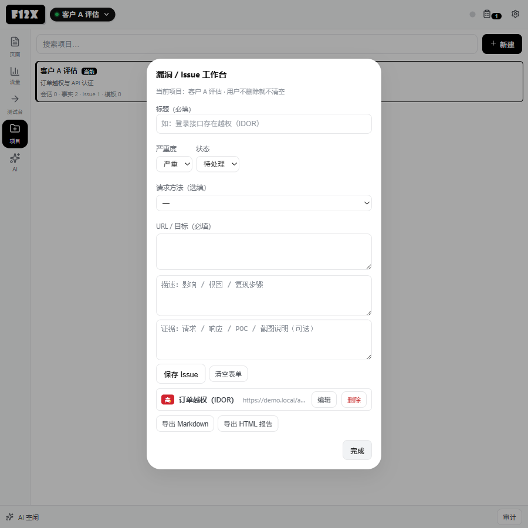

# F12x（Chrome MV3 · 当前版本 0.5.1）

浏览器原生、人类主导的 **Web 安全工作台**：页面/JS 侦察、抓包改包、身份/授权矩阵、证据链与可选 AI；授权与注入只是其中一条工作流。手动功能不依赖 AI。
Chrome MV3 扩展，模块化源码，**无构建步骤**，可直接以「加载已解压的扩展程序」安装。

**核心理念：用户是最高驱动者。** 全部手动功能不依赖 AI、不依赖网络与后端；AI 只是辅助工作台。任何 AI 产出都应落到可核对、可留痕的本地记录（黑板 / 审计 / Issue）里，由人最终裁决。

- 无自有后端、无遥测；LLM API Key 只保存在 `chrome.storage.local`，代码内无硬编码密钥。
- 所有记录（Issue、Repeater 历史、待批准、黑板事实、会话审计）同样只存本地。
- **每次改动的历史（改了什么 / 为什么 / 怎么验 / 提交）见 [`CHANGELOG.md`](CHANGELOG.md)**。
- **完整使用手册（逐控件说明 + 配套界面截图）见 [`docs/USER_MANUAL.md`](docs/USER_MANUAL.md)**。

## 界面

以下均为 **900×900 Playwright 实拍**（演示数据）。



| 测试台 | 项目 |
| --- | --- |
|  |  |
| **命令面板** | **Issue 工作台** |
|  |  |

## 快速开始

1. 打开 `chrome://extensions` → 开启「开发者模式」→「加载已解压的扩展程序」，选择本目录。
2. 点浏览器工具栏的 **F12x 图标** 打开 / 聚焦侧边栏（不再注册键盘快捷键，避免与输入法简繁切换冲突）。
3. 工具台默认全部可用，无需任何配置。
4. 若要用 AI 会话：在扩展设置中点「+ 添加模型」建立模型条目（名称 / API Key / Base URL / 模型名，可并存多条并任选默认；默认端点参考 `src/llm.js` 的 `DEFAULT_LLM_ENDPOINTS`：DeepSeek / OpenAI / Anthropic / Ollama(localhost:11434)）。仅填过旧版单组 Key / URL 的配置会在首次打开设置时自动迁移成一条「默认」模型。
   - **本地模型接入**（Ollama / LM Studio）：Base URL 填 `http://127.0.0.1:11434`（或 LM Studio 端口），模型名如 `qwen2.5:7b`，Key 可留空（本地回环自动填占位）。**Ollama 需设置环境变量 `OLLAMA_ORIGINS=*` 后重启**（否则浏览器扩展请求会因 Origin 校验被 403）。扩展对本地回环模型请求自动带 `keep_alive:-1` 常驻，并在空闲期默认开启"本地空闲保活"（`f12x_local_warm`，设置可关）。
5. 改完源码：`chrome://extensions` 点扩展卡片「重新加载」。
   - 改 `src/**` 或 `background.js` → **必须重载**（Service Worker 重新注册，否则仍是旧代码）。
   - 只改 `sidepanel/**` → 关掉侧边栏再打开即可看到。

## 浏览器兼容性

**当前只支持 Chromium 系浏览器；最低 Chrome 116。**

| 浏览器 | 状态 | 说明 |
| --- | --- | --- |
| Chrome 116+ | ✅ 支持 / 主要验证 | 开发与截图均基于 Chrome |
| Edge / Brave / Opera（Chromium 116+） | ⚠️ 应可用，未逐一回归 | 内核与扩展 API 同源；遇到问题请提 Issue |
| Firefox | ❌ 不支持 | CDP 已在 Firefox 141 移除；没有 `chrome.debugger`；侧边栏不是 `sidePanel` |
| Safari | ❌ 不支持 | 没有 `chrome.debugger` / `chrome.sidePanel` |

### 为什么不做 Firefox

不是“换个端口/开个 flag”的事。F12x 的核心链路是：

```text
扩展 chrome.debugger.attach(当前标签页)
  → CDP 命令（Network / Page / Runtime / DOM / Debugger）
  → 网络采集、拦截改包、脚本分析、DOM/JS、截图
```

Firefox 侧同时缺三样东西：

1. **CDP 已移除**：Firefox 141 起只剩 WebDriver BiDi，`remote.active-protocols` 也已移除；不是默认关闭，而是不再提供。
2. **没有 `chrome.debugger`**：Firefox WebExtensions 没有等价的“扩展直接 attach 标签页”API；CDP/BiDi 是远程调试协议，不是扩展 API。
3. **侧边栏 API 不同**：F12x 用 `chrome.sidePanel`；Firefox 只有 `sidebar_action`，manifest 和 UI 壳都要重写。

如果强行支持 Firefox，只有两条路：

- 用 Firefox 的 `webRequest` / `filterResponseData` / `devtools.*` 重做一个**精简版**（拦截改包、完整脚本调试、CDP 级响应控制会缩水）；
- 用 WebDriver BiDi + 外部 driver / native messaging 做**伴侣进程**（功能较全，但破坏“纯扩展、无后端、加载即用”的承诺）。

两条都不是“移植”，而是另起一个 Firefox 后端。当前优先级是保证 Chromium 版本稳定，所以**明确不支持 Firefox**；Firefox 用户请改用 Chrome / Edge / Brave，不建议侧载——扩展能装上，核心功能也会直接不可用。

> 参考：[CDP Retirement in Firefox](https://fxdx.dev/cdp-retirement-in-firefox/)、[Firefox Remote Protocol preferences](https://firefox-source-docs.mozilla.org/remote/Prefs.html)、[Chrome debugger API](https://developer.chrome.com/docs/extensions/reference/api/debugger)、[Chrome sidePanel API](https://developer.chrome.com/docs/extensions/reference/api/sidePanel)。

## 工具台（手动，全部已实现）

| 视图 | 内容 |
| --- | --- |
| 页面 | Inspect 点选生成选择器卡、采集完整 DOM 骨架（全深度 / 全部属性与文本、源码式高亮 + 行号 + 自动换行）、表单枚举、视口 / 整页截图、URL 导航、CSS 选择器搜索 DOM、JS 执行台（支持顶层 await + 历史） |
| 网络 | 实时请求表（缓冲 2000 条）：默认每行只显示方法 / 状态 / URL（唯一标识），类型 / 大小 / 来源在详情「常规」；过滤（URL 正则、元数据搜索、方法 / 状态 / 域 / 类型）、列配置（持久化）、分页（50/页）、请求详情（常规 + 请求头 / 请求体 / 响应头 / 响应体 / 控制台——控制台页签展示**全局最近 60 条**日志，不按请求过滤） |
| 请求 | **Repeater**：**身份选择（Cookie + localStorage/sessionStorage + 认证头，同源事务应用/恢复）**、**授权矩阵（身份 × 对象引用，差异着色）**、**多步序列（变量/提取）**、**语义 diff / 基线（JSON 字段级差异）**、自定义方法 / URL / 头 / 体发送、与上次响应对比、→ Comparer / Decoder、历史（可"存到黑板"）；**Intruder**：`{payload}` 占位注入 URL / 请求体 / 请求头（注入头字段）、自定义静态请求头、payload 文本或文件导入、并发 / 限速 / 停止（真中断）、摘要与逐条结果；**Comparer**：A/B 文本对比、一键交换；**Decoder**：Base64 / URL / Hex 编解码，输出"→ 再编码"链式转换 |
| Cookie | 域名 / 名称过滤、显示值开关、刷新；**列表只显示名称 / 域 / 标志，点击行在下方详情看完整值 / 路径 / 标志**；值可点击复制、`复制全部`；可编辑 / 删除（CDP 写回，失败如实报错） |
| 脚本 | 当前标签页已加载 JS 列表（外链 / 内联标识）、跨脚本源码搜索（命中数 + 首行）、源码行号与命中高亮、上一处/下一处跳转、复制 / 下载 / 送片段给 AI |
| 项目 | **唯一持久化容器（唯一创建/管理入口）**：列表（搜索 / 新建 / 当前标记 / 四项计数）、详情页签（黑板 / 证据 / 请求 / 序列 / Issue / 模板 / 会话），内联新增与编辑；`设为当前` / `导出 JSON` / `备份/导入` / `报告` / `重命名` / `删除`；模板`运行`先选会话（可新建）再下发；事实可`送入 AI`；项目名唯一（重名拒绝） |
| AI | 见下节 |

### 网络拦截（抓包改包）

- 模式：**关 / 拦下一个 / 全量**；待处理横幅显示计数，可「全部放行」。
- 处置弹层支持：**放行（可改请求头）**、**伪造响应**（自定义状态码 + 响应体）、**丢弃请求**、**发送到 Repeater**（放行该请求并把它填进编辑区，由人接手改包）。
- 仅覆盖**请求阶段**（`Fetch` Request stage）；被拦请求会进网络表并标记 `intercepted`。
- 任务运行中用户开拦截 = 接管信号：立即中止任务、待批操作按拒绝处理。SW 重启后残留的待处理请求会被浏览器自动放行，并在控制台留一条说明。

### 请求行的上下文操作

发送到 Repeater / Intruder / Decoder / Comparer / AI、**存到项目黑板**（写入项目事实，自动生成键）、**→ Issue**（快速建单）。

面板快捷键：`Alt+I` 切换 Inspect、`Alt+P` 暂停 / 继续 AI、`Alt+R` 发送 Repeater、`Alt+X` 切换拦截。

## 工作区与记录（人工数据，均可增删改查）

- **Issue（问题单工作台）**：保存在**当前项目**（`project.issues`），用户不主动删除就不清空；旧全局库 `f12x_issues_v1` 启动时自动迁入「迁移项目（旧数据）」。入口是请求行的「→ Issue」；字段含 标题 / 严重度 / 状态 / 请求方法（选填）/ URL（自动增高文本域）/ 描述 / 复现证据；标题不会自动填 URL；可导出 **Markdown / HTML** 报告。
- **上下文可观察性**：会话聊天区顶部可展开面板，显示本轮注入了哪些项目事实（`事实 N/总数`，逐条 key/摘要/置信度）、上下文预算（窗口与来源、实际/估算 tokens、百分比、触发线、压缩目标、保留尾部）、压缩次数与最近一次压缩方式/触发/tokens/时间；任务开始时实时刷新。- **AI 自我认知**：system 自动注入三段生成内容——能力清单（按工具注册表 + 档位 + 批准级别生成，lite 档明确标注不可用工具）、当前环境（项目名 / 事实·Issue·模板计数 / 任务或对话模式 / 档位 / 批准级别）、行为边界（不能建项目/模板/Issue、单标签页采集、拒绝与超时语义、截图仅引用、临时数据 vs 项目数据）。- **AI 黑板**：AI 会话的事实沉淀（`upsert_fact` 等写入，高价值发现自动沉淀）。项目页创建的会话会绑定项目（黑板跨会话共享）；AI 页只展示会话本身，不出现项目概念。
- **会话工作区**：`workspace:{convId}`，记录研讨条目（发现 open/confirmed/overruled、疑问 open/resolved、决策 executing/done）；带证据的发现会自动沉淀黑板；**任务结束即清理**，过程不长期保存。
- **审计**：AI 的动作逐条留痕（工具调用 / 结果 / 审查事件），状态条可展开查看实时动作审计；会话审计随会话持久化（上限 200 条），可在「会话记录 → 审计」回看。
- **截图**：手动截图不落库（弹层直接查看 / 导出 PNG）；AI 任务截图按会话存 `shot:<convId>:<key>`，会话里**只显示引用标记**、点击弹层看原图，**不限数量**，删会话级联删除；图片不进入 LLM 上下文（只把引用 key 给模型）。

## AI 会话工作台

- **会话列表**只显示当前项目的会话 + 独立会话（按更新时间），显示消息数 / 审计数；切换项目后列表随之变化；可重命名、删除（删除会级联清理该会话的黑板发现与溢出区）。
- 模式切换：**任务模式**（可自主调用页面 / 网络等工具）与**对话模式**（纯问答、不执行工具）；模式随会话记忆。
- **禁思考** 开关：主模型不输出思考直接作答 / 行动（任务模式仍可调工具），UI 按会话记忆。
- **模型切换**：输入框上方选择器按会话切换模型（只对本会话生效并记忆；新会话跟随设置中的默认模型；AI 运行中锁定）。
- 思考过程实时可见：折叠的「思考」行（运行中 = 摘要行 + 扫光动画，点击展开正文）；复核审计员回合同样实时可见。
- **计划条**：固定在输入框上方，随推进更新（✓ 完成 / ● 进行 / ○ 待办），由 `plan_write` 落库后推送的 `plan` / `plan_cleared` 事件驱动，不随消息滚动丢失。
- **待批准**：任务模式下工具调用先入批准条（同轮同工具合并）：全部批准 / 勾选批准 / 拒绝（可填拒绝原因回灌模型）。120s 未响应**按拒绝**处理；未决批准持久化（`f12x_pending_approval_v1`），SW 复活后重弹。
- **机制档位**：`auto / lite / full`（`f12x_guard_profile`）。lite 还启用**精简工具面**：仅注入 18 个核心工具且描述截短（大 schema 会让本地小模型 prefill 显著变慢）。auto 下本地模型（127.0.0.1 / localhost）自动精简（任务开始时聊天流会提示"精简模式…"），云端自动完整。
- 中途可「停止」；暂停 / 接管后「继续」会重新侦察当前页面再续跑；同一目标重发可命中 checkpoint 快照续跑。
- **Prompt 导航**：聊天区右侧悬浮目录，按轮跳转；**看门狗**：8s 无事件提示、45s（对话）/ 90s（任务）解锁输入，不阻塞下一次发送。
- **长会话窗口化**：打开历史会话只渲染最近 60 条，顶部「↑ 加载更早的 N 条」按需追加（执行中禁用）；Prompt 导航只覆盖当前已渲染的轮次。

## 核心机制（src/）

| 模块 | 职责 |
| --- | --- |
| `agent.js` | 主决策循环：消息 → 工具调用 / 文本作答 / 计划维护 / 审查触发 / 压缩压力处理 / steering / 暂停恢复 |
| `plan.js` | 消息序列清洗（tool_calls 配对）、工具结果裁剪、上下文压缩（checkpoint 摘要）、锚点块 |
| `executor.js` | 工具注册表 `TOOL_REGISTRY` + 校验 / 超时 / 中断 / 模式分发（manual / task / chat）+ 溢出区（spill） |
| `llm.js` | LLM 调用与流式接收、端点归一化、超时与重试、意图分类、`runChat`、token 估算 |
| `memory.js` | 项目 / 黑板 / 会话 / 工作区 / 技能 / checkpoint / 级联清理与迁移 |
| `guards.js` | 空想、乱猜、未验证结论检测 |
| `errors.js` | 稳定错误码、错误归一化、可重试白名单 |
| `expert_round.js` `experts.js` | 复核审计员的只读回合引擎与定义（≤3 步、只读白名单） |
| `state.js` `bus.js` `router.js` `debugger.js` | 状态广播（带 convId）、事件总线、后台消息路由、CDP 调试封装 |
| `prompts.js` | system 分段注册表 + `TOOL_DEFINITIONS`（工具 schema） |

**执行流程**：主模型按用户目标推进，用 `plan_write`（引擎级工具，不在 executor 注册表，由 `agent.js` 拦截处理）声明 / 更新计划；工具统一经 `dispatchTool` 派发。对抗性审查按**信号驱动**触发（连续结构化失败、同调用连打 ≥5 次、计划停滞 ≥3 轮等），通过 `rebuttal_check` 自检（每任务封顶 4 次）或 `call_expert` 请复核审计员；`call_expert` 对低价值 / 琐碎断言会按设计拒绝（返回 INVALID_REQUEST 风格错误，属正常行为）。

**上下文压缩（方案 010）**：窗口优先取**本次模型**的 `contextWindow`（模型条目 → provider 自动检测 → 全局兜底 → 保守默认 32768，禁止静默默认 131072）；预算 `U = W - 输出预留 - 安全余量`，触发 `H = 0.85U`，压缩目标 `L = 0.55U`，保留尾部 `R = 0.25U`。判断用 provider 返回的**总 `prompt_tokens`（含缓存命中）**，不是 `prompt_tokens - cached`；先确定性地裁剪较早的超大工具结果（保留最近 3 条），仍超 H 才走 LLM 摘要；摘要请求本身受 `historyBudget` 约束，避免压缩器自己超窗。provider 确认溢出时强制压缩一次并重试；单工具结果 > 8k 字符仍自动写入溢出区（`spill:*`）。

设置页为多页结构：**模型与连接 / 上下文与压缩 / AI 行为 / 数据与隐私 / 关于与诊断**。模型详情可填写上下文窗口与最大输出，并支持 provider 自动检测；上下文页展示有效预算、触发线、压缩目标、保留尾部与按模型窗口表。

## 工具清单

executor 注册 27 项，其中 17 项**手动可用**（manualAllowed，手动调用 = 用户即批准人：跳过批准，但保留校验 + 超时 + 审计）：

`get_page_skeleton` `search_dom` `get_network_requests` `get_network_request_detail` `get_cookies` `eval_js` `get_script_list` `get_script_content` `navigate` `get_console_logs` `replay_request` `highlight_element` `screenshot` `decode_text` `compare_responses` `intruder` `read_spilled`

AI 任务专用（不可手动直调）：`upsert_fact` `get_fact` `rebuttal_check` `workspace_note` `call_expert` `get_skill` `list_assets` `get_evidence` `get_asset` `propose_tests`；另有引擎级 `plan_write`。其中 `list_assets/get_evidence/get_asset/propose_tests` 为 G1 只读：AI 可读项目证据/身份/请求/序列/基线/端点原文（不脱敏），`propose_tests` 只生成计划、不发送请求。

`eval_js` 支持 `executionWorld: main | isolated` 与 `allow_tools`（脚本内 `await __f12x_tools.<tool>(args)` 调扩展侧子工具，子工具白名单 12 项、桥接窗口 60s、`eval_js` 结束即关闭）。

## 配置与存储

全部在 `chrome.storage.local`（除标注 localStorage 的两项 UI 记忆）。

| 类别 | 键 |
| --- | --- |
| LLM | `llmConfig`（引擎唯一读取点）、`llm_endpoints`、`f12x_models_v1`（模型条目）、`f12x_model_active`（默认模型 id）；旧版独立键 `llm_api_key` / `llm_base_url` / `llm_model` 仍兼容 |
| 行为 | `approvalLevel`（`read_auto_write_approve` 默认 / `full_auto` / `all_approve`）、`f12x_thinking_limit`（思考字符上限，0=不限）、`f12x_context_window`（压缩窗口）、`f12x_guard_profile`（auto / lite / full）、`f12x_local_warm`（本地空闲保活）、`f12x_ai_mode`·`f12x_ai_nothink`（localStorage，会话 UI 记忆） |
| 数据 | `projects_index_v2`（项目索引）、`project:<id>`（项目：黑板 / Issue / 模板）、`evidence_index_v1` + `evidence:<id>`（证据元数据/正文）、`identity_index_v1` + `identity:<id>`（身份档案）、`identity_txn_v1`（身份切换临时快照）、`sequences_index_v1` + `sequence:<id>`（多步序列）、`baselines_index_v1` + `baseline:<id>`（接口基线）、`requests_index_v1` + `request:<id>`（请求资产）、`inventory:<projectId>`（端点清单）、`active_project_v1`、`conversations_index_v2`（会话元数据索引）、`conv:<convId>`（单会话全文）、`active_conv_v2`、`skills_data`、`f12x_repeater_history_v1`、`f12x_pending_approval_v1`、`f12x_intercept_snapshot_v1`、`shots_index_v1`（截图索引） |
| 会话级 | `workspace:{convId}`、`spill:{convId}:{key}` + `spill_index:{convId}`、`shot:<convId>:<key>` + `shot_index:<convId>`（会话截图，无上限） |

淘汰与上限：会话 100 个（保留活跃会话）、单会话消息 400 条、`events` 500 条、黑板事实 500 条 / 项目、工作区条目 2000 条、审计 200 条、网络 2000 条、控制台 200 条、溢出区 30 条 / 会话（**截图不设上限**，随会话删除）。旧版全量数组 `conversations_v2` 会在扩展启动时**自动迁移**为「索引 + 每会话一键」。

## 运行限制与容量

| 项 | 值 |
| --- | --- |
| 工具超时 | 默认 30s；`navigate` / `get_script_content` 60s；`intruder` 300s（可中断，超时会真正停止） |
| 批准等待 | 120s，超时按拒绝 |
| 导航 | 发出后 400ms 起轮询 `readyState`，总超时 15s（超时返回失败，不给假成功）；`javascript:` URL 直接拒绝 |
| `eval_js` | `Runtime.evaluate` + `awaitPromise`，30s |
| 响应体读取 | 默认 3000 字符起，支持 `offset/limit` 分段；`replay_request` 响应体封顶 500k 字符 |
| Repeater 重放 | 同源：页面上下文 `fetch`（12s 超时，失败回退扩展 `fetch`）；跨域：扩展 `fetch`（15s 超时，无会话 Cookie） |
| 页面骨架 | 完整 DOM（`DOM.getDocument depth=-1`），不设深度 / token / 文本上限；全部属性保留；script/style 只保留标签（内容走「脚本」页）；结果区源码式高亮、行号、闭合标签，可切换自动换行 |
| 脚本源码 | 跨脚本搜索最多 300 个脚本 / 每脚本 20 处；单脚本 >10MB 拒绝读取，未指定区间 / grep 时 >50 万字符截断 |
| Intruder | 结果上限默认 500 条；响应体默认不返回（勾选后单条 ≤20000 字符）；`{payload}` 必须出现在 URL / body / headerInject 之一 |
| 页面浮条 | 执行指示条约 1.5s、导航指示条约 2.6s 后自动消失；`highlight_element` 高亮 6s 后自动清除 |

## 开发与验证

无构建、无测试框架，验证靠三件事：

```powershell
cd F12x

# ① 全量语法自检（Node 24 的 --check 对 ESM 与经典脚本都可用）
Get-ChildItem src\*.js | ForEach-Object { node --check $_.FullName; if ($LASTEXITCODE) { "FAIL $($_.Name)" } }
node --check sidepanel\panel.js
node --check sidepanel\icons.js
node --check background.js

# ② manifest 合法性
node -e "const m=require('./manifest.json');console.log(m.name,m.version,m.manifest_version)"
```

③ **手动回归**（改完必过）：重载扩展 → 点击工具栏 F12x 图标 → 页面骨架 / 网络列表+详情 / Repeater 发送 / Intruder 开始与结果表 / Decoder / Cookie 读取 / 脚本源码；碰 AI 链路再补：对话一问、任务模式一轮（含批准条）、停止 / 接管 / 继续。日志前缀：`[F12x]` `[Agent]` `[CDP]` `[ExpertRound]` `[Blackboard]` `[Checkpoint]`。

**git 约定**：一主题一提交，中文信息带 `feat:` / `fix:` / `docs:` / `refactor:` / `perf:` / `chore:` 前缀，正文写清"改了什么 + 为什么 + 怎么验"。每次实质改动必须同时在 [`CHANGELOG.md`](CHANGELOG.md) 追加一条（模板与规则见文件头）。本地过程文档（`方案_v*`、`REGRESSION_*`、`压缩机制对齐_harness.md` 等）不入库，见 `.gitignore`。

## 目录结构

- `manifest.json` `background.js` — MV3 声明与 Service Worker（port 注册、bus→panel 桥、消息路由、20s 保活、启动清理）
- `src/` — 核心模块（见上表）
- `vendor/open-props` `vendor/open-props-theme.css` — 设计令牌
- `CHANGELOG.md` — 改动台账：每次实质改动一条（改了什么 / 为什么 / 验证 / 提交 hash），新条目置顶
- `docs/USER_MANUAL.md` + `docs/images/` — 使用手册（逐控件说明与界面截图），随版本更新
- 根目录其余 `*.md` — 设计 / 调研 / 回归记录：本地工作副本（含 `REGRESSION_*`）不入库

## 已知边界（如实说明）

- 拦截仅请求阶段（放行 / 改头 / 伪造响应 / 丢弃），暂无响应阶段拦截。
- 采集是**单标签页**的：切换标签页会 detach 旧会话并清空网络 / 脚本 / 控制台缓冲（同时清空面板列表），旧站数据不保留；要对比两站请分别落 Issue / 黑板。
- **同源 Repeater** 走页面上下文 `fetch`（自动带会话 Cookie，含 httpOnly），因此受页面 `connect-src` CSP 约束；12s 超时写在页面上下文内部，失败会自动回退扩展 `fetch`（无会话 Cookie）并在 `note` 里标注原因。
- `get_cookies` 只读当前调试目标的 Cookie（`Network.getCookies`），不是第三方分区全量视角。
- `get_skill` 只读取存储中已安装的技能内容，未安装时返回 NOT_FOUND，属预期。
- `call_expert` 拒绝低价值复核是设计行为；「反过度思考」的 Plan 触发阈值待积累真实统计数据后再校准。
- 本地小模型（如 qwen2.5:7b，CPU）**任务模式每轮耗时 20–30s**（prefill+生成固有）；已加入 lite 精简工具面、宽松引导提示与"文本轮被吞 ≥5 次自动放行"兜底；在 CDP 自动化驱动下任务全链路不稳定，建议在真实面板人工验证。
- 页面浮条为 **F12x 黑白样式**，注入目标页面；`screenshot` 定位为**取证**（图片不进 LLM 上下文，仅供人查看，保留最近 5 张）。
- Ollama + Intel Arc（iGPU/Vulkan）在空闲后首个请求有数秒~数十秒唤醒延迟（本地保活默认开启缓解；仍明显则更新显卡驱动或改用 CPU/LM Studio）。
- token 估算为字符启发式（CJK 偏保守），不是精确 tokenizer。
- 网络列配置持久化（`networkColumns`）；分页页码等其余 UI 偏好为**会话内**状态、不持久化。
- Issue 入口：顶栏剪贴板图标（有 Issue 时显示数量）+ 网络详情「→ Issue」。
- Intruder「停止」已接线（`tool:intruder_stop` → `AbortController`，工具逐请求检查 signal 并返回 `interrupted`）；请求头与注入头在面板已可填。
- Cookie 的「显示值」开关只决定是否向浏览器读取 value；列表始终按掩码渲染，点击单元格才显示完整值；同名 Cookie 只命中第一条，删除 / 编辑按 `https://域名` 拼 URL。

## 路线图

- 清理 Repeater / 矩阵 / 序列的展示层上限（500KB / 256KB / 64KB），统一完整结果与分片读取。
- AI 测试计划一键应用到矩阵/序列；矩阵/序列单元格增加「AI 分析」入口。
- 报告内嵌截图；备份包可选会话与截图。
- 请求资产编辑/分组；端点清单与基线联动 diff。

## 许可证

本项目以 **GNU Affero General Public License v3.0 only（AGPL-3.0-only）** 开源，版权归 朝悦（GitHub [@gu437](https://github.com/gu437)）所有。

- 可以自由使用、修改、分发、提交改进；
- 衍生作品（包括作为网络服务提供）必须继续以 AGPL-3.0-only 开源；
- 闭源商用需另行取得版权人授权。

详见 [`LICENSE`](LICENSE) 与 [`NOTICE`](NOTICE)。贡献指南见 [`CONTRIBUTING.md`](CONTRIBUTING.md)；第三方组件许可见 [`THIRD_PARTY_NOTICES.md`](THIRD_PARTY_NOTICES.md)。

## 安全

漏洞请通过 GitHub Security Advisories 私下报告，不要公开 Issue。详见 [`SECURITY.md`](SECURITY.md)。