# F12x 使用手册（v0.3.0）

> 本手册覆盖**界面上所有可交互控件**：它们在哪个视图、点了会发生什么、有什么前提或坑。
> 截图来自 Chromium 中真实加载的扩展，数据是演示数据（`demo.local`），不是真实目标。
> 版本以 `manifest.json` 为准；界面文案可能随版本微调，但控件位置与职责稳定。
>
> 0.3.0 起：**Scope 已整体移除**；**站点工作区已下线**，其数据自动迁入同名「项目」（项目视图见方案 001 / P6）。

目录

1. [安装与打开](#1-安装与打开)
2. [界面骨架](#2-界面骨架)
3. [页面视图](#3-页面视图)
4. [网络视图](#4-网络视图)
5. [网络详情与拦截](#5-网络详情与拦截)
6. [请求视图（Repeater / Intruder / Comparer / Decoder）](#6-请求视图)
7. [Cookie 视图](#7-cookie-视图)
8. [脚本视图](#8-脚本视图)
9. [项目（持久化容器）](#9-项目持久化容器)
10. [AI 会话工作台](#10-ai-会话工作台)
11. [设置](#11-设置)
12. [Issue 工作台](#12-issue-工作台)
13. [快捷键](#13-快捷键)
14. [四个典型工作流](#14-四个典型工作流)
15. [已知限制](#15-已知限制)
16. [数据存在哪](#16-数据存在哪)

---

## 1. 安装与打开

1. `chrome://extensions` → 右上角开启「开发者模式」→「加载已解压的扩展程序」→ 选择 `F12x` 目录。
2. 任意网页按 **Ctrl+Shift+F** 呼出 / 聚焦工具台；也可点浏览器工具栏的 F12x 图标（默认打开侧边栏）。
3. 改了源码：`src/**` 或 `background.js` 必须点扩展卡片「重新加载」；只改 `sidepanel/**` 关掉侧栏再开即可。

> 工具台**不需要任何配置**就能用全部手动功能；AI 是可选增强。

---

## 2. 界面骨架

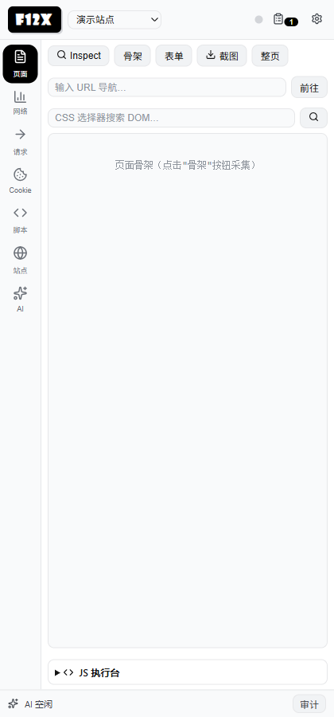

### 2.1 顶栏

| 控件 | 位置 | 作用 | 注意 |
| --- | --- | --- | --- |
| `F12x` 标识 | 左 | 品牌位，不可点 | — |
| `AI` 徽章 | 右侧 | 表示已配置模型 | 未配置时不显示 |
| 连接状态点 | 右侧 | 灰=未附加调试器，黑/绿=已附加 | 点任意采集类功能会自动附加 |
| Issue 按钮（剪贴板图标） | 右侧 | 打开 Issue 工作台；有 Issue 时角标显示数量 | 也可从网络详情「→ Issue」进入 |
| 设置（齿轮） | 最右 | 打开设置弹层 | 模型、机制档位都在这里 |

### 2.2 左侧导航

`页面 / 网络 / 请求 / Cookie / 脚本 / AI` 六个视图（项目视图见方案 001 / P6）。切换带过渡动画（系统开启"减弱动效"时自动关）。

### 2.3 底部状态条

| 控件 | 作用 |
| --- | --- |
| 状态文字 | AI 运行状态：空闲 / 思考中 / 执行中 / 待批准 / 已停止 / 错误 |
| `接管` | 中止当前 AI 任务并暂停，交给人手动操作（手动操作 = 用户即批准人） |
| `继续` | 暂停/接管后重新侦察当前页面并续跑原任务 |
| `停止` | 直接结束本轮任务 |
| `审计` | 展开/收起实时动作审计（工具调用、结果、批准、审查事件） |

> 任务运行中**切换标签页或开启拦截**会被视为"接管"：任务立即中止，待处理批准按拒绝处理。

---

## 3. 页面视图

### 3.1 工具栏

| 按钮 | 作用 | 说明 |
| --- | --- | --- |
| `Inspect` | 进入点选模式：鼠标移到页面元素上高亮，点击生成选择器卡片 | 再点一次退出；扩展页/内部页不支持 |
| `骨架` | 采集页面结构树（标签、关键属性、文本） | 超预算自动截断；结果区可点层级 |
| `表单` | 枚举页面表单与输入项（含同源 iframe） | 跨域 iframe 只计数、不可读 |
| `截图` | 截当前视口 | 只留证，不进 AI 上下文；不落库，弹层可导出 PNG |
| `整页` | 截整页（可滚动区域） | 超长页面会被限制在 4000×10000 |
| URL 输入框 + `前往` | 导航当前标签页 | `javascript:` 被拒绝（防绕过批准）；内部页改用标签页打开 |
| CSS 选择器输入 + 🔍 | 在当前 DOM 里查元素 | 返回属性与前若干字符文本 |
| `JS 执行台`（底部折叠条） | 展开 JS 执行台 | 支持顶层 `await`；`Ctrl/Cmd+Enter` 执行；有会话内历史 |

### 3.2 Inspect 选择器卡片（点选元素后出现）

| 按钮 | 作用 |
| --- | --- |
| 复制选择器 | 把生成的 CSS 选择器复制到剪贴板 |
| 高亮 | 在页面上再次高亮该元素（6s 后自动消失） |
| 送 AI 分析 | 自动切到 AI 并**新建/复用一条会话**，把元素信息填进输入框；已配置模型则直接发送，未配置则只填不发 |
| 精确调试 | 同上，但带上 HTML 源码 + 事件监听器 JS + 匹配 CSS，作为完整调试任务发送 |

卡片内还会显示：元素标签、属性、文本片段、HTML 片段、已绑定事件监听器（类型 / 是否 once / 脚本位置 / 代码片段）、命中的 CSS 规则。

### 3.3 JS 执行台

- `执行`：运行输入框里的代码（默认主世界，可切隔离世界）；结果按 JSON 打印；
- `历史`：下拉最近执行过的片段，点击回填；
- 注意：`eval_js` 是任意代码执行，没有沙箱（见「已知限制」）。

---

## 4. 网络视图

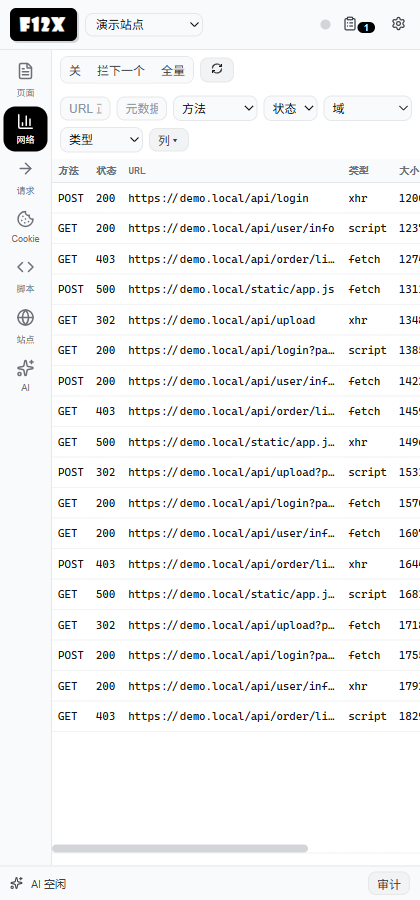

### 4.1 顶栏控制

| 控件 | 作用 | 说明 |
| --- | --- | --- |
| `关 / 拦下一个 / 全量` | 拦截模式 | `拦下一个` 只拦下一个请求；`全量` 拦所有请求（可一键全部放行） |
| `全部放行`（拦截横幅内） | 放行队列里所有待处理请求 | 关闭拦截时自动清队列 |
| ⟳ 刷新 | 重新读取后台缓冲 | 切标签页会自动清空并刷新 |
| URL 过滤 | 正则过滤（大小写不敏感） | 输入即生效 |
| `元数据` 搜索 | 在 URL / 请求头 / 响应头 / 请求体里搜关键字 | 200ms 防抖，结果高亮 |
| 方法 / 状态 / 域 / 类型 下拉 | 组合过滤 | 与 URL 过滤叠加 |
| `列` | 配置显示列（方法/状态/URL/类型/大小/来源） | 保存在 `networkColumns` |
| 分页 | 每页 50 条，`上一页 / 下一页` | 超过 50 条才出现 |

### 4.2 表格与行内操作

每行显示：方法、状态、URL、类型、大小、来源（`⚡`=用户重放产生的请求）。行尾两个按钮：

- `详情`：打开下方详情面板；
- `发送▾`：菜单包含 → Repeater / Intruder / Decoder / Comparer / AI（带过去后不自动发送）。

**容量**：后台缓冲最多 2000 条（FIFO），控制台 200 条。

### 4.3 详情面板

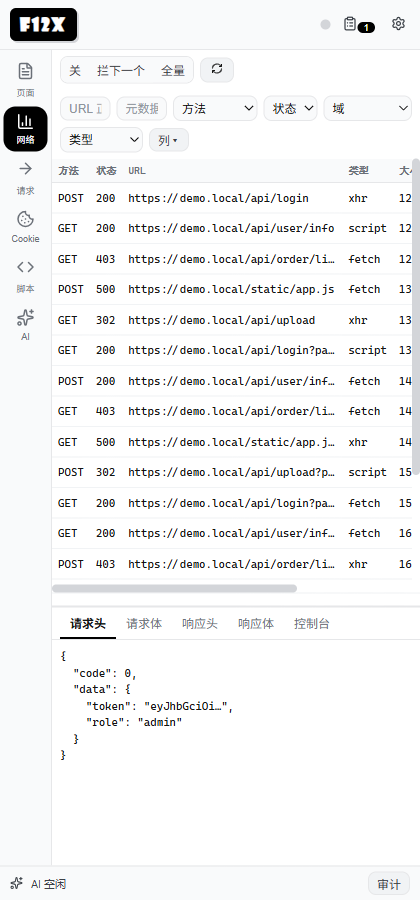

五个页签：

| 页签 | 内容 |
| --- | --- |
| 请求头 | 完整请求头（含 Cookie 等 wire 头） |
| 请求体 | POST body（CDP 取不到时用页面钩子兜底） |
| 响应头 | 响应头（Set-Cookie 常在这里） |
| 响应体 | 响应正文；JSON 可树形展开；默认读 3000 字符，可"继续读取" |
| 控制台 | **全局最近 60 条**页面日志（不按该请求过滤） |

详情操作条 7 个按钮：`→ Repeater`、`→ Intruder`、`→ Decoder`、`→ Comparer`、`→ AI`、`存到项目黑板`（写入项目事实）、`→ Issue`（带方法与 URL 新建问题单）。

---

## 5. 网络详情与拦截

### 5.1 拦截处置弹层

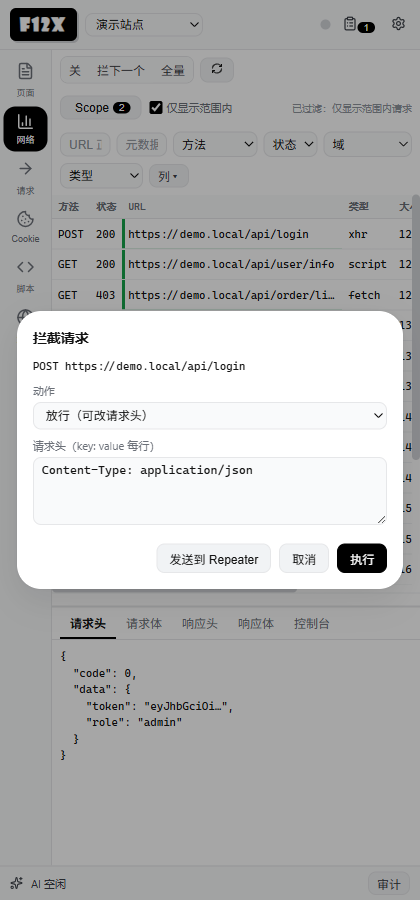

| 控件 | 作用 |
| --- | --- |
| 动作下拉 | `放行（可改请求头）` / `伪造响应` / `丢弃请求` |
| 请求头文本框 | 逐行 `key: value`；放行时替换原请求头 |
| 响应状态码 / 响应体 | 仅"伪造响应"时显示 |
| `发送到 Repeater` | 放行该请求，并把方法/URL/头/体填进 Repeater 由人改包 |
| `取消` | 关闭弹层（请求仍挂在队列里，需另行处置） |
| `执行` | 按所选动作处置 |

> 拦截只覆盖**请求阶段**；关闭拦截、切换标签页、SW 重启都会放行残留请求。

---

## 6. 请求视图

### 6.1 Repeater

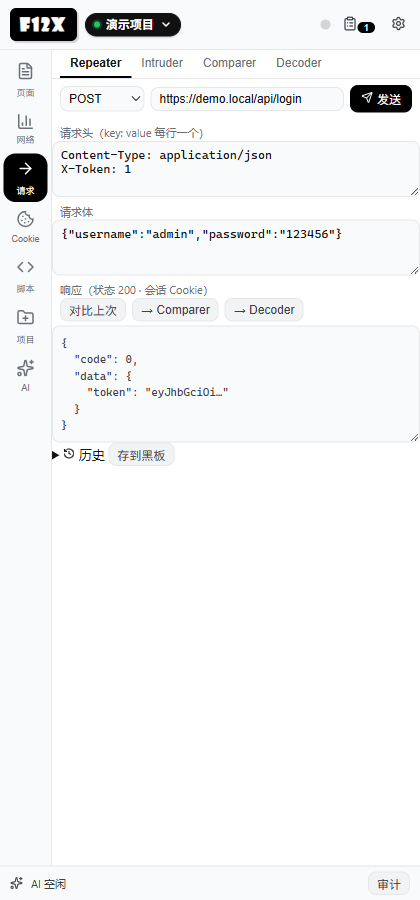

| 控件 | 作用 |
| --- | --- |
| 方法下拉 / URL 输入 | 目标与方法 |
| 请求头文本框 | 逐行 `key: value` |
| 请求体 | 原始 body |
| `发送` | 发请求；同源走页面上下文（自动带会话 Cookie），跨域走扩展 fetch（无 Cookie） |
| `对比上次` | 与上一次响应做差异对比（长度/相似度/差异块） |
| `→ Comparer` | 把上次响应填进 Comparer 的 A 侧 |
| `→ Decoder` | 把上次响应填进 Decoder 输入 |
| `存到黑板` | 把最近 15 条历史写成项目的一条黑板事实（key=`repeater-history`） |
| 历史列表项 | 点击只回填**方法与 URL**（头/体不恢复） |

### 6.2 Intruder

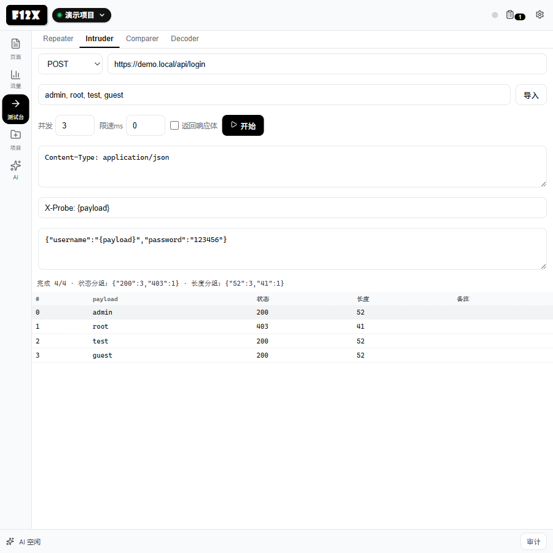

| 控件 | 作用 |
| --- | --- |
| 方法 / URL | 目标；URL 里可写 `{payload}` |
| payload 文本框 | 逗号或换行分隔 |
| `导入` | 从 `.txt/.csv` 读 payload（每行一个） |
| 并发（1–20，默认 3） | worker 数 |
| 限速 ms | 每个请求后等待，防 WAF |
| `返回响应体` | 勾选后每条结果带响应体（单条 ≤20000 字符） |
| `开始` | 启动；按 payload 数封顶 500 条 |
| `停止` | **真正中断**：不再发新请求，摘要显示「已中断（发出 N/M）」；已发出的那一个会跑完 |
| 请求头 | 静态头，逐行 `key: value` |
| 注入头 | 形如 `X-Probe: {payload}`，值里的占位符按 payload 替换 |
| 请求体 | 可含 `{payload}` |
| 结果表 | # / payload / 状态 / 长度 / 备注；状态分组与长度分组用于一眼找异常 |

### 6.3 Comparer

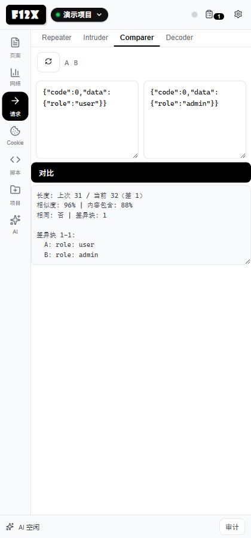

A/B 两段文本 → `对比` → 输出长度差、相似度、内容包含度、差异块。`交换` 交换 A/B。

### 6.4 Decoder

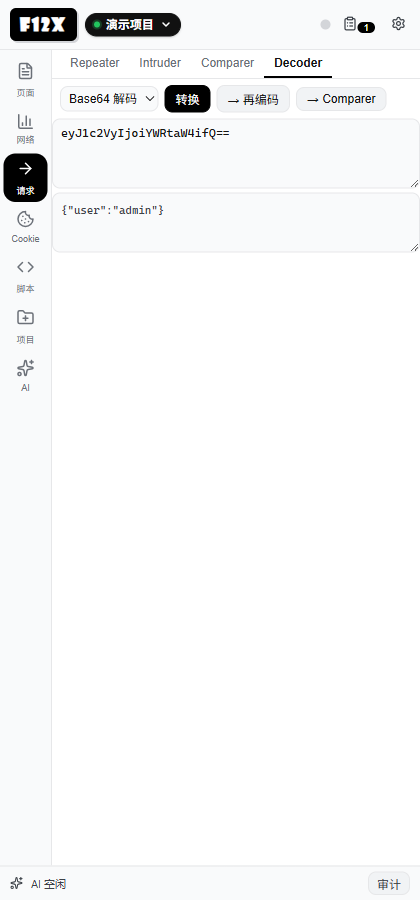

| 控件 | 作用 |
| --- | --- |
| 模式 | Base64 编码/解码、URL 编码/解码、Hex 编码/解码 |
| `转换` | 对输入执行当前模式 |
| `→ 再编码` | 把输出结果当作输入，继续链式转换 |
| `→ Comparer` | 把输出送进 Comparer |
| 输入 / 输出 | 文本区域；输出只读 |

支持指定解码字符集（如 GBK）用于非 UTF-8 页面。

---

## 7. Cookie 视图

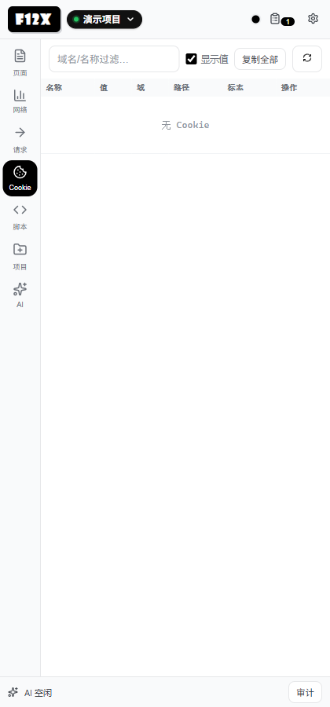

| 控件 | 作用 |
| --- | --- |
| 过滤框 | 按名称 + 域过滤 |
| `显示值` | 取消勾选时**不向浏览器读取 value**（列表只显示占位） |
| ⟳ | 重新读取当前域 Cookie |
| 值单元格 | 默认掩码（前 4 位 + `****`），点击显示完整值，再点隐藏 |
| `编辑` | 弹层可改 名称 / 值 / 域 / 路径；确定后通过 CDP 写回，失败会提示 |
| `删除` | 按 `https://域名 + 路径` 删除 |

> 只读当前调试目标的 Cookie；同名 Cookie 只命中第一条。

---

## 8. 脚本视图

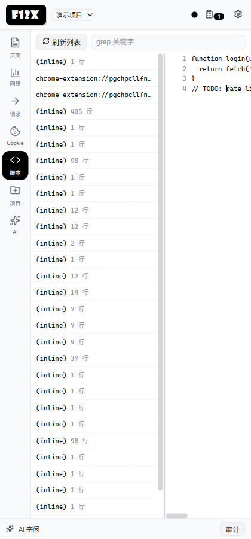

| 控件 | 作用 |
| --- | --- |
| ⟳ | 重新拉取脚本列表 |
| grep 输入（回车） | 在源码里高亮关键字，默认最多 20 处 |
| 左侧列表项 | 点击加载源码（带行号，命中行高亮） |
| `送片段给 AI` | 有选区则发送选区，否则取前 60 行（截断 4000 字符）填进聊天输入框 |

源码 >10MB 会被拒绝读取；超过 50 万字符且没指定行区间/grep 时自动截断。

---

## 9. 项目（持久化容器）

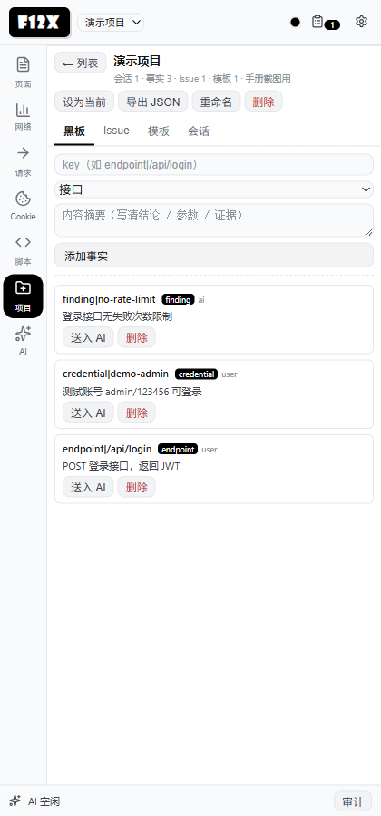

项目是**唯一长期保存数据的地方**：黑板事实、Issue、模板、会话都挂在项目下。

### 9.1 项目列表

| 控件 | 作用 |
| --- | --- |
| 顶栏项目选择器 | 切换当前项目；Issue 与「存到项目黑板」写入当前项目 |
| `搜索项目` | 按名称 / 描述过滤 |
| `新建` | 展开新建栏（名称必填 + 描述可选），创建后自动设为当前 |
| 项目条目 | 名称 / 描述 / 四项计数 / `当前` 标记；点击进入详情 |

### 9.2 项目详情

| 控件 | 作用 |
| --- | --- |
| `← 列表` | 回到项目列表（当前项目不变） |
| `设为当前` | 把该项目设为当前（Issue / 手动黑板写入目标） |
| `导出 JSON` | 下载 `f12x-project-<名称>.json`（项目全文 + 归属会话列表） |
| `重命名` / `删除` | 删项目会删黑板 / Issue / 模板；**会话只解绑、不删除** |

四个页签与联动：

- **黑板**：内联新增（key + 分类 + 摘要）；每条可 `送入 AI`（切换 AI 并把事实填进输入框）或 `删除`。网络详情「存到项目黑板」也写这里。
- **Issue**：内联表单新建 / 编辑（标题、严重度、状态、方法、URL、描述、证据），保存即持久，只有主动删除才消失；也可从网络详情「→ Issue」进入。
- **模板**：新增（名称 / 类型 / 目标 URL / 执行提示）；`运行` 会**新建一条绑定该项目的会话并直接下发任务**（可在 AI 页随时停止）；`删除` 移除。
- **会话**：`新建会话` 建一条绑定该项目的会话并直接打开；已有会话可 `打开` 或 `解绑`（解绑后回到独立会话 / AI 全局黑板）。

> 删除项目是"删除容器"，不是"删除全部痕迹"：需要留档请先导出 JSON / Issue 报告 / 截图。

---

## 10. AI 会话工作台

### 10.1 会话列表

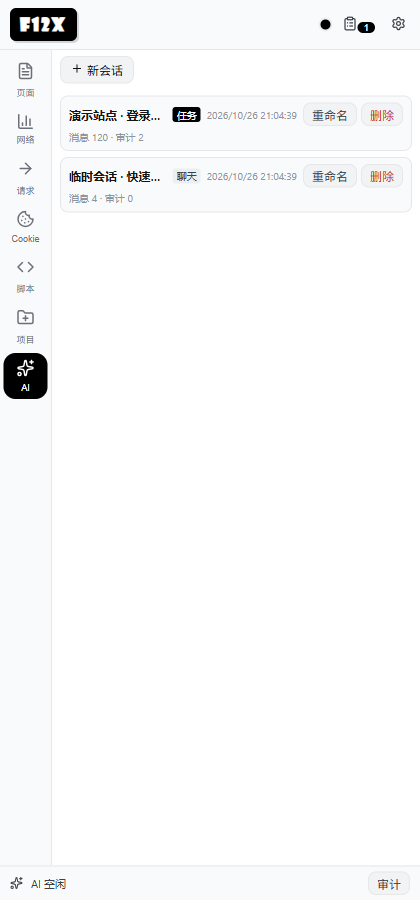

| 控件 | 作用 |
| --- | --- |
| `+ 新会话` | 新建空会话 |
| `+ 新项目` | 新建项目（用于跨会话共享黑板） |
| 会话条目 | 点开详情；标题右侧 `重命名` / `删除`（删除会级联清理该会话的黑板发现与溢出区） |
| 分组 | 按项目分组；未绑定归入「独立会话」 |

### 10.2 聊天页

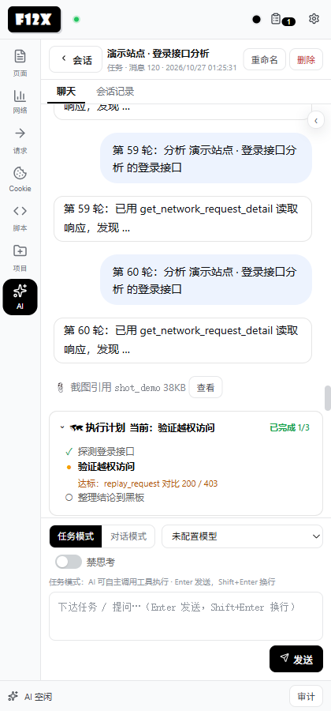

| 控件 | 作用 |
| --- | --- |
| `返回` | 回到会话列表 |
| `绑定项目 / 改绑` | 把会话挂到某个项目（共享该项目黑板） |
| `重命名` / `删除` | 会话级操作 |
| `任务模式 / 对话模式` | 任务=可调工具并需批准；对话=纯问答不执行工具 |
| 模型下拉 | 按会话记忆所用模型；`默认` 跟随设置；运行中锁定 |
| 禁思考开关 | 不输出思考过程，直接作答/行动（任务模式仍可调工具） |
| 输入框 + `发送` | 发送（`Enter` 发送，`Shift+Enter` 换行） |
| `停止` | 结束本轮（执行中显示） |
| 计划条 | 固定在输入框上方：✓ 完成 / ● 进行 / ○ 待办，由 `plan_write` 驱动 |
| Prompt 导航 | 右侧悬浮目录：折叠/展开、按轮跳转（`<620px` 自动折叠） |
| `↑ 加载更早的 N 条` | 长会话默认只渲染最近 60 条，点击按需加载（执行中禁用） |
| `📎 截图引用 <key>` | AI 任务截图后出现；点击弹层看原图 / 导出 PNG；**不限数量**，删会话即删图 |
| `📝 研讨 …` 行 | 主代理写研讨条目的实时回显 |

思考过程显示为可折叠的「思考」行；复核审计员回合同样实时可见（含每步 ✓/✗）。

### 10.3 会话记录页

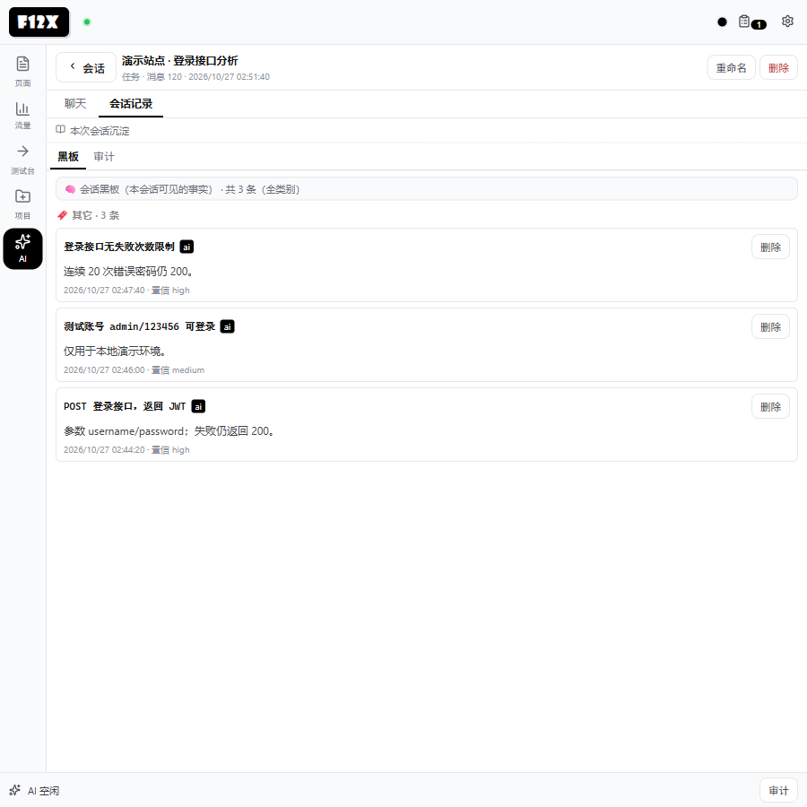

| 子页签 | 内容 |
| --- | --- |
| 黑板 | 该项目（或 AI 全局）的事实清单：key、摘要、分类、置信度、时间、`删除` |
| 审计 | 该会话的动作留痕（工具 / 结果 / 批准 / 审查） |
| 轨迹 | archify workflow 引擎渲染的执行流程（4 条泳道 + 节点/边数） |

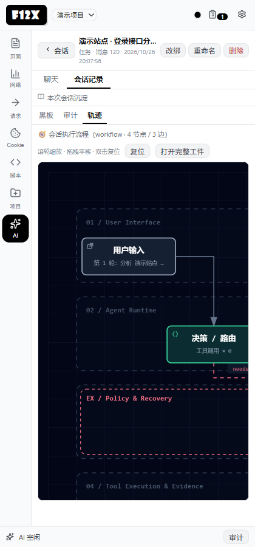

轨迹工具条：滚轮缩放、拖拽平移、双击复位、`复位`、`打开完整工件`（下载 `f12x-trace.html`，用官方查看器打开）。

### 10.4 批准弹层

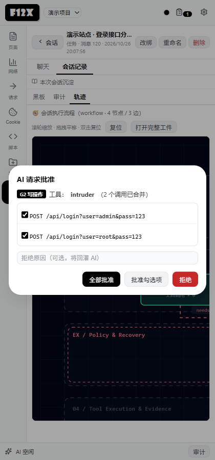

| 控件 | 作用 |
| --- | --- |
| 级别徽章 | G1 读操作 / G2 写操作 / G3 不可逆 |
| 调用列表 | 同轮同工具的多个调用合并展示，逐条勾选 |
| 拒绝原因 | 可选，会回灌给模型 |
| `全部批准` | 批准所有勾选（默认全勾） |
| `批准勾选项` | 只批准勾中的 |
| `拒绝` | 拒绝并回传原因 |

> 120s 未响应按**拒绝**处理；后台重启后未决批准会重新弹出。

---

## 11. 设置

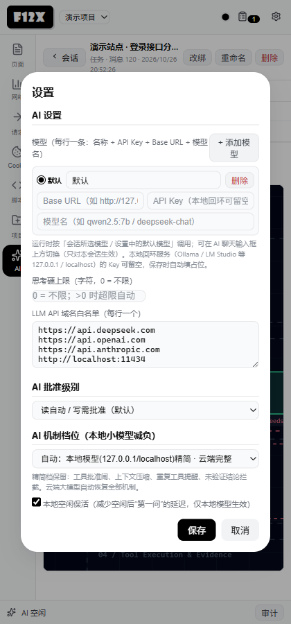

| 控件 | 作用 |
| --- | --- |
| `+ 添加模型` | 新增一条模型（名称 / Base URL / API Key / 模型名） |
| 模型行首 `默认` 单选 | 设为默认模型（新会话跟随；本设置页内即改即生效） |
| 模型行 `删除` | 删除该条 |
| 思考上限 | 字符数；0=不限。超限自动切"直接作答" |
| LLM API 域名名单 | 每行一个端点（仅作默认值参考，不是白名单） |
| AI 批准级别 | 读自动/写需批准（默认）、全部自动、全部需批准 |
| 机制档位 | auto（本地精简/云端完整）、始终精简、始终完整 |
| 本地空闲保活 | 空闲期每 40s 发一次 1-token 请求，缓解本地模型冷启动 |
| `保存` / `取消` | 保存会先做轻校验（默认模型必须填 Base URL 与模型名；本地回环 Key 可空） |

---

## 12. Issue 工作台

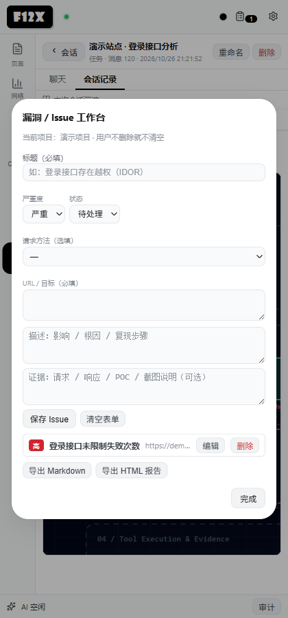

| 控件 | 作用 |
| --- | --- |
| 列表项 `编辑` | 回填到表单 |
| 列表项 `删除` | 删除该条（确认后） |
| 标题 | 必填项；新建时**不会**自动填 URL |
| 严重度 | 严重 / 高 / 中 / 低 / 信息 |
| 状态 | 待处理 / 已确认 / 已修复 / 不修复 |
| 请求方法（选填） / URL | URL 会自动增高 |
| 描述 / 复现证据 | 自由文本 |
| `保存` | 新建或更新当前编辑项 |
| `清空` | 清空表单并退出编辑态 |
| `导出 Markdown` / `导出 HTML 报告` | 下载整份报告 |

入口：顶栏剪贴板按钮；或任意请求详情「→ Issue」。

> Issue 保存在**当前项目**（弹层顶部显示项目名）；用户不主动删除就不会清空，重启浏览器仍在。删除会二次确认且不可恢复。

---

## 13. 快捷键

| 快捷键 | 作用 |
| --- | --- |
| `Ctrl+Shift+F` | 呼出 / 聚焦侧边栏（浏览器级命令） |
| `Alt+I` | 切换 Inspect |
| `Alt+P` | 暂停 / 继续 AI |
| `Alt+R` | 发送 Repeater（输入框内也可用） |
| `Alt+X` | 切换拦截开/关 |
| `Ctrl/Cmd+Enter` | 执行 JS 台代码 |
| `Enter` / `Shift+Enter` | 聊天发送 / 换行 |

---

## 14. 四个典型工作流

### 14.1 手动抓包改包

1. 打开目标页 → `Ctrl+Shift+F` → 网络 → 等请求出现（或先开「全量」拦截）；
2. 点某行 `详情` 看请求/响应；
3. `→ Repeater` → 改参数/头 → `发送`；
4. 与上次响应 `对比上次`，或在 Intruder 里批量跑 payload；
5. 有结论 → `→ Issue` 或 `存到项目黑板`。

### 14.2 爆破 / 枚举

1. 请求 → Intruder；
2. 填 URL/体，写 `{payload}`；导入 payload；
3. 设并发 3、限速 100ms，勾选"返回响应体"；
4. `开始` → 看状态/长度分组找异常 → `停止` 可随时中断；
5. 结果通过 → Repeater 复现 → Issue。

### 14.3 让 AI 干活

1. 设置里配模型（本地 Ollama 填 `http://127.0.0.1:11434`，Key 留空）；
2. AI → 新会话 → 选任务模式 → 描述目标；
3. 计划条出现后观察执行；写操作会弹批准（可勾选/拒绝/填原因）；
4. 中途可 `接管` 手动操作，完了 `继续`；
5. 结束后看「会话记录 → 黑板 / 审计 / 轨迹」，结果落 Issue。

### 14.4 沉淀与复用

1. 抓包时把关键结论「存到项目黑板」（写入项目事实，Key 自动生成）；
2. Repeater 历史「存到黑板」（写一条 `repeater-history` 事实）；
3. 需要长期保留的结论走 Issue（项目内持久，只有主动删除才消失）或导出 Markdown / HTML；
4. 项目视图（黑板 / Issue / 模板 / 会话）见方案 001 / P6，上线后可在这里统一回看。

---

## 15. 已知限制

- **采集是单标签页的**：切换标签页会 detach 旧会话并清空网络/脚本/控制台缓冲（列表也会清空），旧站数据不保留。
- **`eval_js` 不是沙箱**：任意代码执行，可在页面里 fetch 任意地址，工具台不做拦截。
- **拦截仅请求阶段**：可放行/改头/伪造响应/丢弃，暂无响应阶段拦截。
- **轨迹是静态 SVG**：CSP 禁止内联查看器脚本，完整交互需「打开完整工件」下载。
- **截图不进 LLM 上下文**：手动截图不落库（可导出 PNG）；AI 任务截图按会话存引用，点击可看原图，不限制数量，删会话即删图。
- **控制台页签是全局最近 60 条**，不按请求过滤。
- **本地小模型**（如 qwen2.5:7b CPU）任务模式每轮 20–30s，建议开精简档。

---

## 16. 数据存在哪

- 全部在 `chrome.storage.local`（外加两项 UI 记忆在扩展页 `localStorage`）；无自有后端、无遥测。
- 会话是**索引 + 每会话一键**：`conversations_index_v2`（元数据）+ `conv:<id>`（正文）。
- 溢出区 `spill:<convId>:<key>` + `spill_index:<convId>`；会话截图 `shot:<convId>:<key>` + `shot_index:<convId>`。
- 旧版 `conversations_v2` 全量数组会在扩展启动时自动迁移。
- 卸载扩展会**一并删除**这些数据；需要留存请先用 Issue 导出或自行备份。

---

*手册版本：2026-10-26 · 对应 F12x 0.3.0*
